  

<h1 align="center">Bonjour développeur ✦</h1>

<em>I write some codes when I’m happy.</em>

  

**Languages**

**Tech Stack**

Always open to interesting projects.

  

<em>快乐主义编程！Ciallo～(∠・ω&lt; )⌒☆</em>

